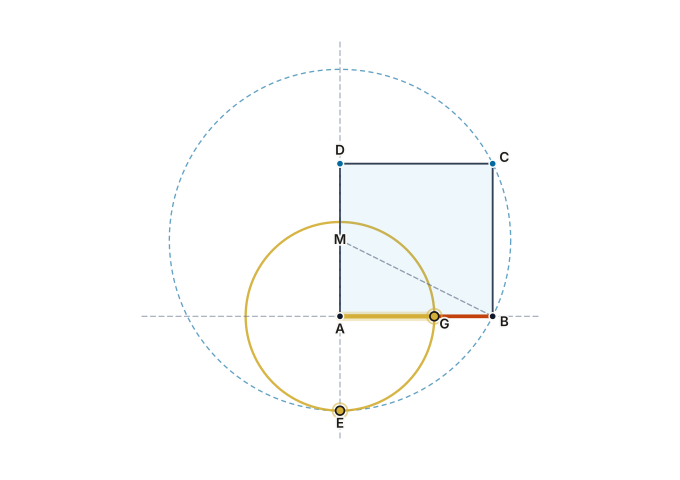

GEOMETOR • posamentier
======================

**Visit the Online Archive:** https://geometor.github.io/posamentier/

**Posamentier & Lehmann • The Glorious Golden Ratio • semantic digital archive**

Mission
-------

``geometor/posamentier`` is part of the interconnected `GEOMETOR <https://geometor.com>`_ semantic digital archive. It provides an exact symbolic mathematical catalog and cross-corpus concordance inspired by Alfred S. Posamentier and Ingmar Lehmann's treatise *The Glorious Golden Ratio* (2011). By decomposing their wide-ranging geometric constructions, algebraic identities, and continued fractions into certified SymPy models and calibrated vector graphics, the archive establishes an interconnected, machine-verifiable foundation across the GEOMETOR corpus.

Catalogs in This Archive
------------------------

- `The Glorious Golden Ratio — Mathematical Catalog & Concordance <https://geometor.github.io/posamentier/catalog/>`_ — Exact symbolic mathematical catalog and multi-work concordance of Posamentier and Lehmann's golden ratio theorems.

Repository Contents
-------------------

- ``docsrc/`` — RST catalog tracks, guides, and concordances compiled by `PHOTON publish <https://github.com/photon-platform/publish>`_.
- ``resources/`` — Curated mathematical manifests and cross-corpus concordance registries.
- ``src/geometor/posamentier/`` — Symbolic modeling modules, CLI tools, and catalog validators.

Local Build & Verification
--------------------------

.. code-block:: bash

   publish build
   uv run --no-sync pytest

Part of the GEOMETOR Knowledge Archive
--------------------------------------

Explore all **74 Book Codices** and **11 Mathematical Catalogs** at https://geometor.com/books/.
