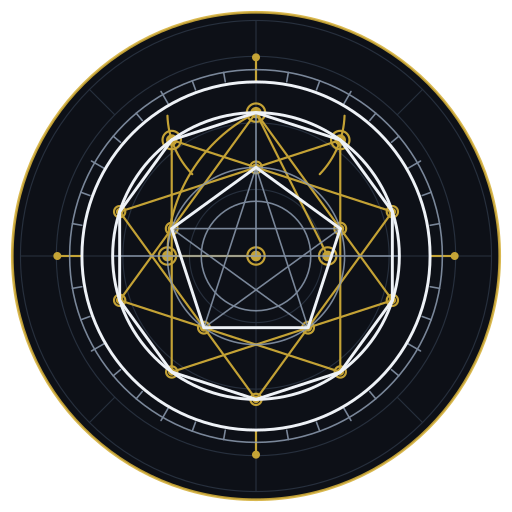

.. container:: author-overline

   semantic digital archive • mathematical catalog

======================================
Alfred S. Posamentier & Ingmar Lehmann
======================================

**Alfred S. Posamentier** and **Ingmar Lehmann** assembled one of the richest modern anthologies of golden-ratio constructions and surprises in *The Glorious Golden Ratio* (2011). From sixteen distinct ruler-and-compass and Mascheroni constructions of :math:`\phi` to George Odom's equilateral-midline chord, Star of David hexagram sections, and golden fractal trees, their work celebrates how a single proportion recurs across unexpected geometric settings. This mathematical catalog formalizes their theorems in exact SymPy algebra over :math:`\mathbb{Q}(\phi)` with calibrated vector plates.

Inside This Reference
---------------------

.. container:: home-book-hero

   .. container:: home-book-thumb plate-light

      .. image:: catalog/01-constructions/pos-1-01.svg
         :alt: Classical Square Side-Midpoint Arc Extension constructing the Golden Ratio
         :target: catalog/index.html

   .. container:: home-book-body

      .. rubric:: Prometheus Books · 2011 · 4 Collections · 16+ Exact Constructions

      **The Glorious Golden Ratio — Mathematical Catalog & Concordance** — Atomic golden-ratio constructions (``POS-1.01``–``POS-1.16``), Kepler's :math:`1:\sqrt{\phi}:\phi` triangle, golden cuboids, triangle and circle gems, and an Appendix of Formulas verified in exact SymPy arithmetic.

      .. container:: home-actions

         * :doc:`Open Mathematical Catalog → <catalog/index>`
         * :doc:`16 Constructions → <catalog/01-constructions/index>`
         * :doc:`Triangle & Circle Gems → <catalog/03-triangle-and-circle-gems/index>`

Key Features
------------

.. container:: home-feature-grid

   .. container:: home-feature-card

      **16-Construction Equivalence Matrix**

      Compares every golden-section construction side-by-side—distinguishing classical equivalents of Euclid II.11 and VI.30 from net-new circle-and-grid constructions.

   .. container:: home-feature-card

      **Calibrated Euclid-Graphic SVGs**

      Twenty custom ``.euclid-graphic`` vector plates highlight major and minor golden segments, auxiliary arcs, Kepler triangles, and Euler nine-point circles.

   .. container:: home-feature-card

      **Exact** :math:`\mathbb{Q}(\phi)` **Algebra & Formulas**

      Verifies continued fractions, Binet/Lucas/Cassini identities, Millin series, and fractal self-similarity ratios in symbolic SymPy without floating-point rounding.

Reference & Project
-------------------

.. container:: home-columns

   .. container:: home-col

      .. rubric:: Scholarly Apparatus

      * :doc:`People <people/index>` — Profiles of Posamentier, Lehmann, Ana Lúcia Braz Dias, and referenced geometers
      * :doc:`Bibliography <bibliography>` — Primary 2011 edition, triangle monographs, and historical sources
      * :doc:`Glossary <glossary>` — Definitions of golden cuboids, Mascheroni constructions, and geometric invariants

   .. container:: home-col

      .. rubric:: About This Project

      * :doc:`About <about/index>` & :doc:`Using This Edition <usage/index>` — Scope, symbolic methodology, and navigation guide
      * :doc:`Demos <demos/index>` & :doc:`Python Modules <modules/index>` — Interactive scripts and exact symbolic validators
      * :doc:`Project Log <log/index>`, :doc:`Todos <todos/index>`, :doc:`Changelog <changelog>` & :doc:`Connect <connect>`

.. toctree::
   :hidden:
   :maxdepth: 2

   catalog/index
   about/index
   people/index
   bibliography
   usage/index
   demos/index
   todos/index
   log/index
   modules/index
   glossary
   changelog
   connect
